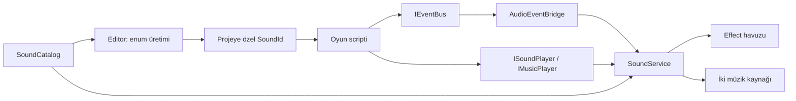

# Audio System

Unity için tek ses kataloğu, projeye özel üretilen enum ID’leri, 2D/3D ses havuzu ve iptal edilebilir müzik geçişleri sunan C# paketi. VContainer, Event Bus, UniTask ve DOTween ile çalışır.

Sesleri bir kez `SoundCatalog` içine eklersin. Inspector’daki **Generate Sound IDs** butonu `SoundId` enum’unu ve kullanım metotlarını üretir. Oyun scriptlerine ayrı ayrı ses asset’i sürüklemeden ses çalabilirsin:

```csharp
using Game.Audio;

_soundPlayer.Play(SoundId.UiClick);
_soundPlayer.PlayAt(SoundId.UiClick, transform.position);
_soundPlayer.PlayAttached(SoundId.EngineLoop, transform);
_events.PublishSound(SoundId.UiClick);
```

Buradaki `_soundPlayer`, VContainer’dan alınan `ISoundPlayer`; `_events` ise `IEventBus` örneğidir. Aşağıdaki bölümlerde sahne kurulumu ve çalışan component örneği bulunur.

## İçindekiler

- [Gereksinimler ve kurulum](#gereksinimler-ve-kurulum)
- [İlk sahne kurulumu](#ilk-sahne-kurulumu)
- [Hangi parça ne işe yarar?](#hangi-parça-ne-işe-yarar)
- [Katalog ve ses ayarları](#katalog-ve-ses-ayarları)
- [Enum üretimi ve ID kuralları](#enum-üretimi-ve-id-kuralları)
- [VContainer ile kullanım](#vcontainer-ile-kullanım)
- [2D ve 3D ses API’si](#2d-ve-3d-ses-apisi)
- [Müzik ve iptal davranışı](#müzik-ve-iptal-davranışı)
- [Event Bus ile kullanım](#event-bus-ile-kullanım)
- [Volume, mute ve mixer](#volume-mute-ve-mixer)
- [Ses havuzu ve limitler](#ses-havuzu-ve-limitler)
- [Örnek sahne](#örnek-sahne)
- [Testler ve geliştirme](#testler-ve-geliştirme)
- [Sorun giderme](#sorun-giderme)

## Gereksinimler ve kurulum

| Gereksinim | Doğrulamada kullanılan sürüm | Görevi |
| --- | --- | --- |
| Unity | 6000.3.15f1 | Editor ve ses altyapısı |
| UniTask | 2.5.11 | Await edilebilir müzik işlemleri |
| VContainer | 1.19.0 | Servis kaydı, injection ve yaşam döngüsü |
| Event Bus | 1.0.0 | Ses komutlarını olaylar üzerinden iletme |
| DOTween | 1.3.030 | Müzik fade/crossfade işlemleri |

Paket manifest’i Unity **2022.3** alt sınırını bildirir. Bu repodaki doğrulama Unity **6000.3.15f1** ile yapılmıştır; diğer Editor sürümleri için test matrisi henüz bulunmaz. Runtime’da URP/HDRP bağımlılığı yoktur.

### 1. Önce bağımlılıkları kur

**Window > Package Manager > + > Install package from git URL** üzerinden aşağıdaki paketleri bu sırayla ekle:

**UniTask**

```text
https://github.com/Cysharp/UniTask.git?path=src/UniTask/Assets/Plugins/UniTask#2.5.11
```

**VContainer**

```text
https://github.com/hadashiA/VContainer.git?path=VContainer/Assets/VContainer#1.19.0
```

**Event Bus**

```text
https://github.com/kameryurdakull/unity-eventbus.git?path=/Packages/com.kameryurdakull.eventbus#v1.0.0
```

Ardından [DOTween’i resmi kaynaktan](https://dotween.demigiant.com/download.php) projene import et. **Tools > Demigiant > DOTween Utility Panel > Setup DOTween...** işlemini tamamla. Audio System, `DG.Tweening` çekirdek API’sini kullanır; DOTween Pro gerekmez. `DOTween.dll` dosyasının Plugin Inspector’daki **Auto Reference** seçeneği açık olmalıdır.

Unity, paketler arası Git URL bağımlılıklarını `package.json` içinde desteklemez. Bu yüzden önceki Git paketlerini projenin kendisine kurmak gerekir. Audio System manifest’inde bu bağımlılıkların semver gereksinimleri tanımlıdır; DOTween ayrıca import edilir. Bu adımın nedeni [Unity’nin Git bağımlılıkları dokümanında](https://docs.unity3d.com/6000.3/Documentation/Manual/upm-git.html) açıklanır.

### 2. Audio System’i ekle

Paket yapısı GitHub’a gönderildikten sonra kullanılacak URL:

```text
https://github.com/kameryurdakull/unity-audio-system.git?path=/Packages/com.kameryurdakull.audiosystem#main
```

`main`, geliştirme dalındaki içeriği alır. `v1.0.0` etiketi yayımlandığında sürümü sabitlemek için `#main` yerine `#v1.0.0` kullanılabilir. `.git` uzantısı, `?path` ve `#revision` sıralaması [Unity’nin Git URL kurallarına](https://docs.unity3d.com/6000.3/Documentation/Manual/upm-git.html#paths-and-revisions) uygundur.

Paketlerin hepsini proje manifest’i üzerinden eklemeyi tercih edersen, `Packages/manifest.json` içindeki mevcut `dependencies` nesnesine aşağıdaki kayıtları birleştir:

```json
{
  "dependencies": {
    "com.cysharp.unitask": "https://github.com/Cysharp/UniTask.git?path=src/UniTask/Assets/Plugins/UniTask#2.5.11",
    "jp.hadashikick.vcontainer": "https://github.com/hadashiA/VContainer.git?path=VContainer/Assets/VContainer#1.19.0",
    "com.kameryurdakull.eventbus": "https://github.com/kameryurdakull/unity-eventbus.git?path=/Packages/com.kameryurdakull.eventbus#v1.0.0",
    "com.kameryurdakull.audiosystem": "https://github.com/kameryurdakull/unity-audio-system.git?path=/Packages/com.kameryurdakull.audiosystem#main"
  }
}
```

Bu örnek manifest’in tamamının yerine geçmez; projendeki diğer dependency kayıtlarını koru. DOTween import’u bu JSON tarafından yapılmaz.

### 3. Assembly referanslarını ekle

Assembly definition kullanmayan scriptler için ek işlem gerekmez. Kendi `.asmdef` dosyan varsa kullandığın API’lere göre şu referansları ekle:

| Assembly | Ne zaman gerekir? |
| --- | --- |
| `AudioSystem.Runtime` | Ses arayüzleri, handle, options ve VContainer registration |
| `AudioSystem.Generated` | Varsayılan klasöre üretilen `Game.Audio.SoundId` |
| `VContainer` | `[Inject]` ve container kurulumu |
| `EventSystem` | `IEventBus` ve event tipleri |
| `UniTask` | Async müzik metotları ve `.Forget()` |

Özel bir generated klasörü kullanırsan, o klasördeki `.asmdef` dosyasının `name` değerini referans olarak kullan. Varsayılan dışındaki assembly adları namespace ve enum adı ile ayrılır.

## İlk sahne kurulumu

1. **Tools > Audio System > Setup** penceresini aç.
2. **Create Settings Asset** ile `AudioSystemSettings` oluştur.
3. **Create Sound Catalog** ile tek `SoundCatalog` oluştur.
4. Kataloğun Inspector’ında `+` ile ses ekle. `Id` alanına örneğin `UiClick` yaz; `Data > Clips` listesine ses dosyanı ekle. Örnekteki diğer çağrıları kullanacaksan `EngineLoop`, `MenuMusic` ve `GameplayMusic` kayıtlarını da oluştur.
5. **Generate Sound IDs** butonuna bas ve derlemenin tamamlanmasını bekle.
6. Setup penceresinde settings ve catalog seçiliyken **Create Audio Manager In Scene** butonuna bas.
7. Sahnede aktif bir `AudioListener` bulunduğundan emin ol; genellikle ana kameradadır.

Manager üzerindeki `AudioSystemScope`, VContainer üzerinden servisi kurar ve uygun scope/üst scope içinde mevcut Event Bus’ı kullanır; yoksa kendisi kaydeder. Ses isteyen MonoBehaviour’leri bu scope’un **Auto Inject Game Objects** listesine ekle. Halihazırda bir oyun scope’un varsa aşağıdaki [VContainer örneğini](#vcontainer-ile-kullanım) kullanarak aynı kurulumu mevcut scope’unda yapabilirsin.

Aynı ses sistemini aynı sahne için iki kez kurma: ya hazır `AudioSystemScope` kullan ya da kendi scope’unda `RegisterSoundSystem` çağır. Servis ömrü onu kaydeden VContainer scope’una bağlıdır. Kalıcı bir oyun root scope’u, sistemin sahne değişimleri arasında yaşamasını sağlar; sahneye bağlı scope dispose edildiğinde sesler durdurulur ve kaynaklar temizlenir.

## Hangi parça ne işe yarar?

| Parça | Sorumluluğu |
| --- | --- |
| `SoundCatalog` | Tüm ses kayıtlarını, ID isimlerini ve enum üretim ayarlarını tutan tek ScriptableObject |
| `SoundCatalogEntry` | Bir sesin string ID’si, kalıcı sayısal ID’si ve `SoundData` ayarlarını bir araya getirir |
| `SoundData` | Clip varyasyonları, volume, pitch, loop, limit, bus ve 3D ayarları; ayrı bir asset gerektirmez |
| Üretilen `SoundId` | Kodda string kullanmadan ses seçmeni sağlayan projeye özel enum |
| `SoundKey` | Katalog kimliği + sayısal ID; paketin projeye özel enum’u tanımadan çalışmasını sağlar |
| `AudioSystemSettings` | Genel effect havuzu boyutu, taşma politikası ve başlangıç master volume |
| `AudioBus` | İsteğe bağlı mixer yönlendirmesi ve bir grup ses için volume/mute kontrolü |
| `AudioSystemScope` | Hazır sahne manager’ı; DI, Event Bus ve ses servisinin yaşam döngüsünü kurar |
| `ISoundPlayer` | Effect/loop seslerini çalma ve tüm effect’leri durdurma |
| `IMusicPlayer` | Müzik çalma, geçiş ve fade out işlemleri |
| `IAudioControls` | Master ve bus volume/mute kontrolü |
| `ISoundService` | Bu üç arayüzü birleştirir; ayrıca runtime diagnostics sağlar |
| `SoundHandle` | Tek bir effect playback’ini durdurma, pause/resume ve volume kontrolü |
| `PlaybackOptions` | Tek çağrı için volume, pitch ve loop override |
| Event tipleri | Ses taleplerini `IEventBus` üzerinden servise iletir |

Runtime’daki `SoundService` bu arayüzlerin aynı singleton örneğidir. `SoundLibrary` kataloğu başlangıçta doğrular ve ID lookup tablosunu kurar. `SoundVoicePool` effect kaynaklarını yeniden kullanır; `MusicController` iki ayrı müzik kaynağı arasındaki geçişleri yönetir. `AudioEventBridge` olaylara abone olur ve scope kapanınca abonelikleri kaldırır.



## Katalog ve ses ayarları

Katalog satırını açıp `Data` içindeki ayarları düzenle:

| Alan | Açıklama |
| --- | --- |
| `Clips` | Bir veya daha fazla varyasyon. Birden fazla clip varsa effect playback’lerinde önceki varyasyonun hemen tekrar seçilmesi engellenir. Eksik/null clip bırakılmamalıdır. |
| `Bus` | İsteğe bağlı `AudioBus`. Atanmazsa ses doğrudan master kontrolüne bağlıdır. |
| `Volume` | Sesin temel volume değeri, 0–1. |
| `Pitch Range` | Effect çalındığında rastgele seçilen pitch aralığı. Son playback pitch’i 0.01–3 aralığına sınırlandırılır. |
| `Loop` | Effect veya müziğin tekrarlaması. Müzik sürekli tekrar etsin istiyorsan bu alanı aç. |
| `Priority` | Küçük değer daha yüksek önem demektir. `32`, `128` değerinden daha önemlidir. |
| `Max Instances` | Bu effect kaydının aynı anda kaç kez çalabileceği. Pause edilmiş sesler de sayılır. |
| `Cooldown Seconds` | Effect talepleri arasında gereken minimum süre; unscaled time kullanır. |
| `Instance Overflow` | Bu sese özel limite ulaşıldığında yeni çağrıyı reddetme veya en eski örneği değiştirme. |
| `Spatial Mode` | `Play` çağrısının 2D mi 3D mi olacağını belirler. |
| `Min Distance` / `Max Distance` | Unity AudioSource mesafe zayıflama ayarları. |
| `Rolloff` | `Logarithmic` veya `Linear` mesafe zayıflaması. |
| `Doppler Level` | 3D sesler için Doppler etkisi, 0–5. |
| `Target Lost Policy` | Takip edilen Transform yok edilirse sesi durdurma veya son konumda devam ettirme. |

`Max Instances`, cooldown ve overflow ayarları effect havuzuna aittir; müzik kanalı bunları kullanmaz. Müzik 2D çalınır ve pitch’i 1’dir. Mekânsal bir müzik/ambiyans loop’u için `PlayAttached` veya `PlayAt` kullan.

**Preview Selected Sound**, seçili kaydın ham clip’ini dinletir. Volume, pitch, mixer ve 3D sonucu için Play Mode’u kullan. Import alanına AudioClip sürükleyerek kayıt oluşturabilirsin. Önceki sistemden kalan `SoundDefinition` asset’lerini de bu alana bırakarak ayarlarını kataloğa kopyalayabilirsin; runtime artık bu asset’lere ihtiyaç duymaz.

## Enum üretimi ve ID kuralları

| Katalog alanı | Varsayılan |
| --- | --- |
| `Generated Namespace` | `Game.Audio` |
| `Enum Name` | `SoundId` |
| `Generated Folder` | `Assets/AudioSystemGenerated` |

ID’ler C# identifier olmalıdır: `UiClick`, `EngineLoop`, `Explosion_Heavy` gibi. Boş isimler, tekrar eden isimler, `class` gibi keyword’ler ve rakamla başlayan isimler reddedilir. `None = 0` ayrılmıştır; çalınabilir bir ses değildir. Bu üretici ASCII harfleri, rakamları ve `_` karakterini kabul eder.

- Yeni kayıtlar kalıcı sayısal ID alır; enum değerleri liste indeksinden türetilmez.
- Kayıtları sıralamak mevcut sayısal ID’leri değiştirmez.
- Normal silme/ekleme akışında silinen ID yeni bir sese verilmez; sayaç asset içinde saklanır.
- Bir kaydın ID ismini değiştirirsen sayısal ID korunur. Enum’u yeniden üretip eski ismi kullanan kodu güncelle.
- Clip, volume veya 3D ayarı değiştirmek enum’u değiştirmez.
- Başka bir kataloğun ID’si yanlışlıkla oynatılmaz; katalog kimliği doğrulanır.

Enum dosyasını elle düzenleme. ID ekleme/silme/isim değişikliklerinden sonra **Generate Sound IDs** çalıştır. Aynı içerik yeniden üretildiğinde dosya gereksiz yere yazılmaz.

`Generated Folder`, `Assets/...` biçiminde proje yolu veya katalog klasörüne göre `../Generated` gibi göreli bir yol olabilir. Çıktı daima `Assets` altında kalır; kurulu paketin içine veya proje dışına yazılmaz. Böylece Package Manager’dan import edilen örneğin klasörü değişse de kendi enum’u aynı örnek klasörü altında yeniden üretilebilir.

Katalog, clip, üretilen `.cs` ve `.asmdef` dosyalarını **`.meta` dosyalarıyla birlikte** versiyon kontrolüne al. Katalog asset’ini yeni GUID ile yeniden oluşturmak mevcut enum kimliğini değiştirir; bu durumda o katalog için enum üretimini yeniden yap.

## VContainer ile kullanım

Mevcut oyun scope’una entegre etmek için settings ve catalog referanslarını yalnızca scope üzerinde tut:

```csharp
using AudioSystem;
using EventSystem;
using UnityEngine;
using VContainer;
using VContainer.Unity;

public sealed class GameAudioScope : LifetimeScope
{
    [SerializeField] private AudioSystemSettings settings;
    [SerializeField] private SoundCatalog catalog;

    protected override void Configure(IContainerBuilder builder)
    {
        builder.RegisterEventBus();
        builder.RegisterSoundSystem(settings, catalog, transform);
        builder.RegisterComponentInHierarchy<ShipAudio>();
    }
}
```

Sahnede `ShipAudio` component’i bulunmalıdır. Event Bus zaten aynı scope veya üst scope’ta kayıtlıysa `RegisterEventBus` satırını tekrar ekleme. `RegisterSoundSystem`, Event Bus kaydının önce yapılmasını zorunlu tutar.

Ses isteyen component artık SoundCatalog/SoundDefinition referansı taşımaz:

```csharp
using AudioSystem;
using EventSystem;
using Game.Audio;
using UnityEngine;
using VContainer;

public sealed class ShipAudio : MonoBehaviour
{
    private ISoundPlayer _soundPlayer;
    private IEventBus _events;
    private SoundHandle _engine;

    [Inject]
    public void Construct(ISoundPlayer soundPlayer, IEventBus events)
    {
        _soundPlayer = soundPlayer;
        _events = events;
    }

    public void PlayClick() => _soundPlayer.Play(SoundId.UiClick);
    public void PublishClick() => _events.PublishSound(SoundId.UiClick);

    public void StartEngine()
    {
        _engine.Stop();
        _engine = _soundPlayer.PlayAttached(SoundId.EngineLoop, transform);
    }

    private void OnDisable() => _engine.Stop();
}
```

Bu örnekte `EngineLoop` kaydının `Loop` ayarı açık olmalıdır. Bir sınıf yalnızca müzik yönetiyorsa `IMusicPlayer`; yalnızca volume yönetiyorsa `IAudioControls` inject et. Birden fazla API ve diagnostics gerekiyorsa `ISoundService` kullan.

## 2D ve 3D ses API’si

| Metot | Davranış |
| --- | --- |
| `Play(id, options)` | Katalogdaki spatial mode kullanılır. 3D seçilmişse başlangıç konumu dünya merkezidir. |
| `PlayAt(id, position, options)` | Katalog ayarından bağımsız olarak sabit dünya konumunda 3D çalar. |
| `PlayAttached(id, target, localOffset, options)` | 3D çalar, Transform’u takip eder. Offset hedefin local uzayındadır; dönüşü ve ölçeği dikkate alınır. |
| `StopAllEffects()` | Effect havuzundaki tüm playback’leri durdurur; müziği etkilemez. |

```csharp
var options = new PlaybackOptions(volumeScale: 0.7f, pitchScale: 1.1f);
var hit = _soundPlayer.PlayAt(SoundId.UiClick, hitPosition, options);
var engine = _soundPlayer.PlayAttached(SoundId.EngineLoop, transform,
    localOffset: new Vector3(0f, 0f, -2f));

engine.Pause();
engine.Resume();
engine.SetVolume(0.5f);
engine.Stop();
```

`volumeScale`, katalog volume değerini çarpar. `pitchScale`, effect’in seçilen pitch değerini çarpar. `loopOverride`, yalnızca bu playback’in loop davranışını değiştirir. `default(PlaybackOptions)` volume ve pitch için 1 kullanır.

`SoundHandle.IsActive` playback’in pool tarafından hâlâ tutulduğunu, `IsPaused` pause durumunu gösterir. Bir limit talebi reddederse aktif olmayan handle döner. Kaynak yeniden kullanılmışsa eski handle yeni sesi durduramaz; handle metotları `false` döner. Yeni bir sesin çalınamaması her zaman hata değildir: cooldown veya pool limiti beklenen şekilde çağrıyı reddetmiş olabilir.

## Müzik ve iptal davranışı

`IMusicPlayer`, effect havuzundan ayrı **iki AudioSource** kullanır. Geçiş sırasında eski parça kısılırken yeni parça açılır. Süre `0` ise değişim anında tamamlanır.

```csharp
await _musicPlayer.PlayMusicAsync(SoundId.MenuMusic, transitionSeconds: 1f);
await _musicPlayer.PlayMusicAsync(SoundId.GameplayMusic, transitionSeconds: 2f,
    cancellationToken: cancellationToken);
await _musicPlayer.StopMusicAsync(fadeSeconds: 1f, cancellationToken: cancellationToken);
```

Bu kod bir `async UniTask` metodu içinden çağrılır. Beklemen gerekmiyorsa `using Cysharp.Threading.Tasks;` ekleyerek `.Forget()` kullanabilirsin; async işlemlerindeki hata yönetimini oyunun akışına göre yap.

- Token iptali, gelen parçayı bırakır ve önceki parçayı eski seviyesinde geri getirir; await eden çağrı `OperationCanceledException` alır.
- Fade out iptal edilirse önceki müzik devam eder.
- Yeni müzik talebi önceki bekleyen geçişi iptal eder ve yeni talebi devralır. Bu durumda da önceki task iptal edilir.
- Fade işlemleri unscaled update kullanır; `Time.timeScale = 0` durumunda devam eder.
- Scope dispose edildiğinde bekleyen geçiş iptal edilir ve kaynaklar temizlenir.

Geçiş token’ı geçişi yönetir; tamamlanmış bir playback’i sonradan durdurmak için `StopMusicAsync` çağır. Sürekli müzik istiyorsan ilgili katalog kaydında `Loop` ayarını aç. Sistemde playlist, beat senkronizasyonu veya streaming/Addressables loader bulunmaz.

## Event Bus ile kullanım

Üretilen helper metotları string veya manuel `SoundKey` gerektirmeden typed komut gönderir:

```csharp
_events.PublishSound(SoundId.UiClick);
_events.PublishSoundAt(SoundId.UiClick, transform.position);
_events.PublishSoundAttached(SoundId.EngineLoop, transform);
_events.PublishMusic(SoundId.MenuMusic, transitionSeconds: 1f);

_events.Publish(new StopAllEffectsRequested());
_events.Publish(new StopMusicRequested(fadeSeconds: 1f));
```

| Event | Görevi |
| --- | --- |
| `PlaySoundRequested` | Effect’i katalog spatial ayarıyla, sabit konumda veya hedef takibiyle çalma |
| `PlayMusicRequested` | Müzik değişimi/crossfade başlatma |
| `StopMusicRequested` | Müzik fade out başlatma |
| `StopAllEffectsRequested` | Effect havuzunu durdurma |

Event Bus çağrısı bir playback handle veya await edilebilir müzik sonucu döndürmez. Belirli bir loop’u sonra durdurmak, bir geçişi beklemek veya token ile iptal etmek için doğrudan player arayüzünü kullan. Ses olaylarını ve servis çağrılarını Unity ana thread’inden gönder. Müzik geçişine ait token’ın başka thread’den iptali içerde ana thread’e taşınır.

## Volume, mute ve mixer

`AudioBus`, bütün sesleri aynı katalogda tutarken effects/music gibi grupları bağımsız kontrol etmeni sağlar. **Assets > Create > Audio System > Audio Bus** menüsünden oluştur. `Output` alanına istersen bir `AudioMixerGroup` ata; boşsa bus yine volume/mute grubu olarak çalışır.

```csharp
_audioControls.SetMasterVolume(0.8f);
_audioControls.SetMasterMuted(true);
_audioControls.SetBusVolume(effectsBus, 0.6f);
_audioControls.SetBusMuted(musicBus, false);
```

Effect kaynağının volume değeri şu çarpımla belirlenir:

```text
SoundData.Volume × PlaybackOptions.VolumeScale × BusVolume × MasterVolume
```

Müzikte playback scale yerine geçişin fade gain’i kullanılır. Mixer gain’i ve 3D attenuation bu hesabın ardından Unity tarafından uygulanır. Mute, kaydedilmiş volume değerlerini silmez. Volume 0–1 aralığında olmalıdır. `AudioBus` referansları yalnızca merkezi settings/menu kontrolünde gerekebilir; ses isteyen her scriptin bus veya config asset’i taşıması gerekmez.

## Ses havuzu ve limitler

| `AudioSystemSettings` alanı | Görevi |
| --- | --- |
| `Prewarm Voices` | Scope açılırken hazırlanacak effect kaynağı sayısı |
| `Max Voices` | Ayrılabilecek toplam effect kaynağı sınırı; müziğin iki kaynağı bu sayıya dahil değildir |
| `Overflow Policy` | Havuz dolduğunda yeni çağrının davranışı |
| `Master Volume` | Başlangıç master volume değeri |

| Taşma politikası | Sonuç |
| --- | --- |
| `RejectNew` | Yeni effect talebi reddedilir |
| `StealOldest` | En eski aktif playback’in kaynağı yeniden kullanılır |
| `StealLowerPriority` | Yalnızca daha düşük önemdeki bir playback kesilir; eşit veya daha önemli playback korunur |

Önce sesin cooldown ve `Max Instances` kuralları, sonra genel havuz limiti uygulanır. Pause edilmiş playback’ler aktif sayılır ve kaynaklarını korur. Havuz, maksimum değere kadar büyür; playback bittikten sonra ayrılmış kaynaklar sonraki sesler için tutulur.

Diagnostics için `ISoundService.GetDiagnostics()` kullan:

```csharp
var diagnostics = _soundService.GetDiagnostics();
Debug.Log($"Effects: {diagnostics.ActiveEffects}, paused: {diagnostics.PausedEffects}");
Debug.Log($"Pool: {diagnostics.AllocatedEffectSources}/{diagnostics.MaximumEffectSources}");
Debug.Log($"Music: {diagnostics.ActiveMusicSources}, transition: {diagnostics.IsMusicTransitioning}");
```

## Örnek sahne

Package Manager’da **Audio System > Samples > Playback Lab > Import** seç. Unity, örneği `Assets/Samples/Audio System/1.0.0/Playback Lab` altına kopyalar. Örnek kodu kurulu paketin runtime’ına otomatik dahil olmaz; [Unity’nin sample düzeni](https://docs.unity3d.com/6000.3/Documentation/Manual/cus-samples.html) kullanılır.

Import sonrasında **Tools > Audio System > Samples > Select Playback Lab** menüsü sahne asset’ini seçer. `Scenes/AudioPlaybackLab.unity` dosyasını açıp Play Mode’a gir.

Sahnedeki butonlarla şunları deneyebilirsin:

- Doğrudan ve Event Bus üzerinden 2D ses.
- Dinleyicinin sağı/solunda sabit 3D ses.
- Hareket eden küreyi takip eden 3D loop; pause/resume/stop.
- 48 çağrıda 16 kaynaklı effect havuzunun taşma davranışı.
- İki müzik arasında geçiş, token iptali ve fade out.
- Master ve bus volume/mute kontrolleri.

Örnekte sentetik test tonları kullanılır. Kendi oyunun sesleriyle değiştirilebilirler. Örneğin enum’u `AudioSystem.PlaybackLab.Audio.PlaybackSoundId` adını kullanır; oyunun `Game.Audio.SoundId` enum’undan bağımsızdır. Örnek kataloğun generated folder ayarı `../Generated` olduğu için enum yeniden üretimi import edilen örneğin kendi `Generated` klasörüne yapılır.

## Testler ve geliştirme

Repo, paketi geliştirmek için kullanılabilen bir Unity projesi de içerir:

```text
unity-audio-system/
├── README.md
├── Packages/
│   ├── manifest.json
│   └── com.kameryurdakull.audiosystem/
│       ├── package.json
│       ├── README.md
│       ├── CHANGELOG.md
│       ├── Runtime/
│       ├── Editor/
│       ├── Tests/Editor/
│       └── Samples~/PlaybackLab/
├── Assets/
│   ├── AudioSystemDemo/        # Geliştirme sahnesi
│   └── AudioSystemGenerated/   # Geliştirme projesinin enum’u
└── Tools/
    └── Validate-Package.ps1
```

Git URL’deki `?path=/Packages/com.kameryurdakull.audiosystem` yalnızca paket klasörünü hedefler. Unity projesi, DependencyBundle araçları, Unity MCP ve projedeki DOTween kopyası Audio System paketinin bağımlılık içeriğine dahil değildir.

Yerel geliştirme için repo kökünü Unity Hub’dan aç. Paket `Packages` altında embedded olarak bulunur; aynı runtime kodunun `Assets` altında ikinci bir kopyasını ekleme. Root `Packages/manifest.json`, paket testlerini `testables` listesiyle etkinleştirir.

**Window > General > Test Runner > EditMode** üzerinden `AudioSystem.Tests` ve geliştirme projesindeki `AudioSystem.Demo.Tests` assembly’lerini çalıştır. Testler havuz limitleri, eski handle güvenliği, 3D offset/takip, mute/volume, müzik iptali, DI/Event Bus yaşam döngüsü, kalıcı ID’ler, hatalı isimler ve generated çıktı yollarını kapsar.

Başka bir projede paket testlerini çalıştırmak için Unity Test Framework kurulu olmalı ve proje manifest’inde şu alan bulunmalıdır:

```json
{
  "testables": ["com.kameryurdakull.audiosystem"]
}
```

Bu alanı da mevcut manifest’e birleştir. Test assembly’si Editor ile sınırlıdır ve oyuncu build’ine dahil edilmez. Playback Lab örneğinin runtime’ını kullanmak için paket testlerini etkinleştirmek gerekmez.

Paket metadata ve asset yapısı kontrolü:

```powershell
pwsh -File Tools/Validate-Package.ps1
```

Bu kontrol Unity testlerinin yerine geçmez. Yayın öncesinde Unity derlemesi, testler ve örnek import/playback kontrolü de yapılmalıdır. `package.json` sürümü ile yayımlanacak Git etiketi birlikte güncellenir; örneğin `1.0.0` için `v1.0.0`.

## Sorun giderme

| Belirti | Kontrol |
| --- | --- |
| `UniTask`, `VContainer` veya `EventSystem` bulunamıyor | Bağımlılık Git URL’lerini önce kur; kendi asmdef referanslarını kontrol et |
| `DG.Tweening` bulunamıyor | DOTween import ve Setup işlemini yap; `DOTween.dll` Auto Reference açık olmalı |
| `SoundId` bulunamıyor | Katalogdan enum üret, doğru namespace’i import et ve generated asmdef’i referansla |
| `None` veya bilinmeyen ID hatası | Çalınabilir bir enum değeri kullan; ID silindiyse enum ve çağıran kodu güncelle |
| ID başka kataloğa ait | Manager’a atanan katalog ile enum’un üretildiği katalog aynı olmalı |
| Üretilen dosya başka kataloğa ait | Aynı enum dosyasını iki katalog için kullanma; ayrı namespace/enum ve çıktı klasörü seç |
| Handle aktif değil | Cooldown, per-sound limit veya genel pool overflow talebi reddetmiş olabilir |
| Ses duyulmuyor | AudioListener, volume/mute, geçerli clip, mixer ve 3D mesafelerini kontrol et |
| `[Inject]` alanları dolmuyor | Component’i VContainer’a kaydet veya ilgili scope’un Auto Inject listesine ekle |
| `RegisterSoundSystem` Event Bus hatası | Önce aynı scope/üst scope’a `IEventBus` kaydet |
| Müzik bir kez çalıp bitiyor | Katalogdaki müzik kaydının `Loop` ayarını aç |
| Testler görünmüyor | Unity Test Framework ve manifest `testables` alanını kontrol et |

## Lisans ve üçüncü parti bileşenler

Audio System için lisans seçimi yayın öncesinde tamamlanmalıdır. Bağımlılıklar kendi lisanslarıyla dağıtılır; DOTween DLL’i ve bağımlılık kaynak kodları UPM paketine eklenmez. Kaynaklar: [UniTask](https://github.com/Cysharp/UniTask), [VContainer](https://github.com/hadashiA/VContainer), [Event Bus](https://github.com/kameryurdakull/unity-eventbus), [DOTween](https://dotween.demigiant.com/).
